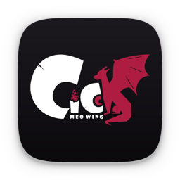
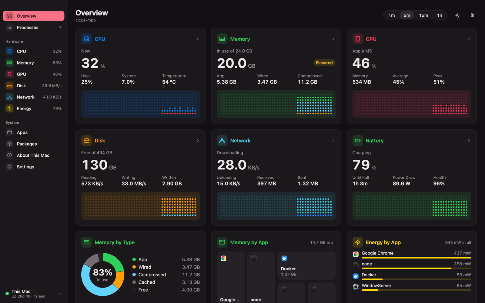
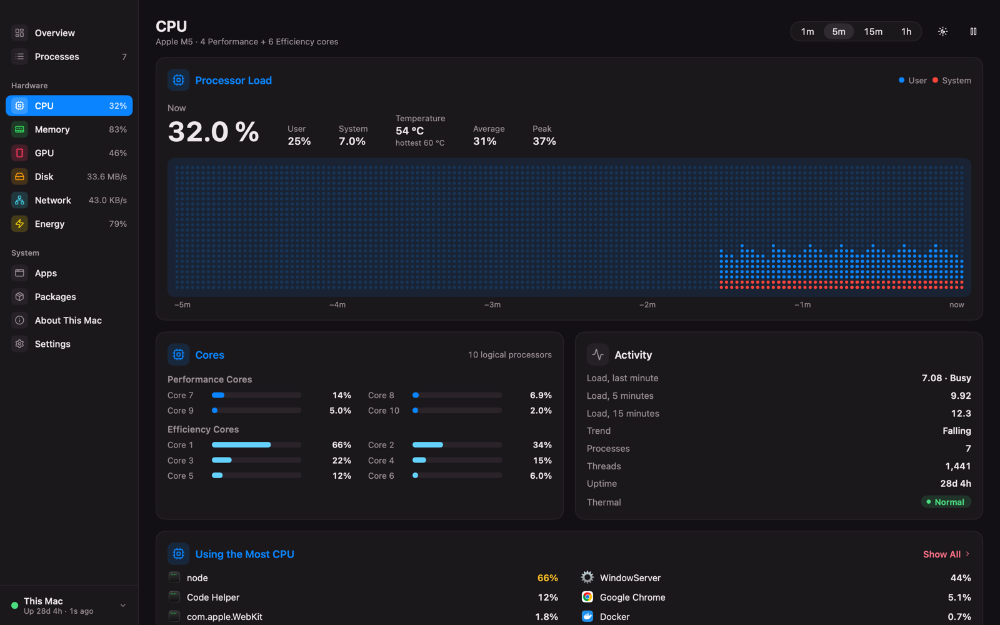
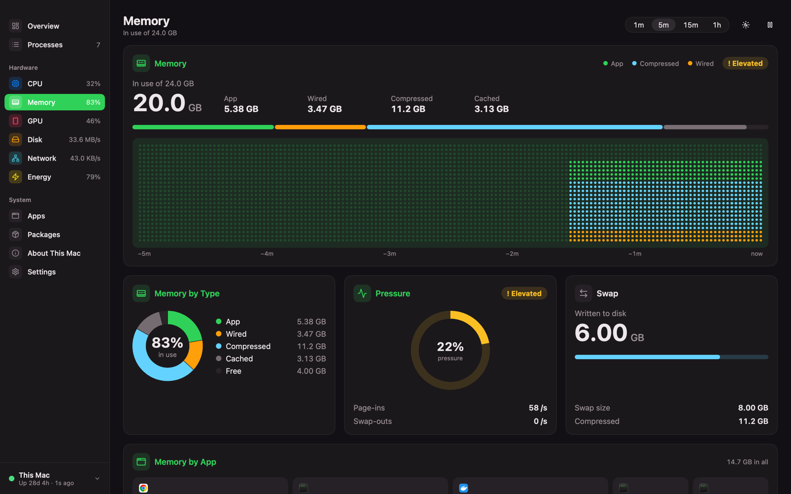
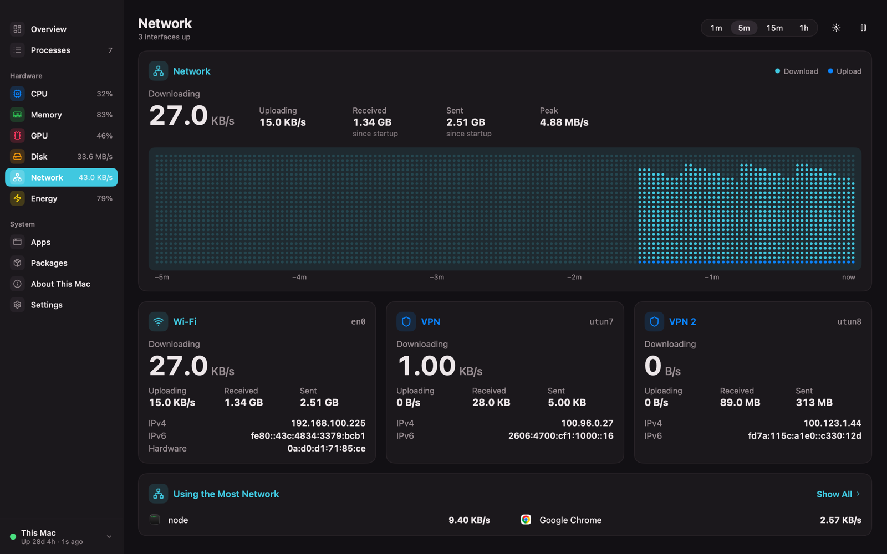
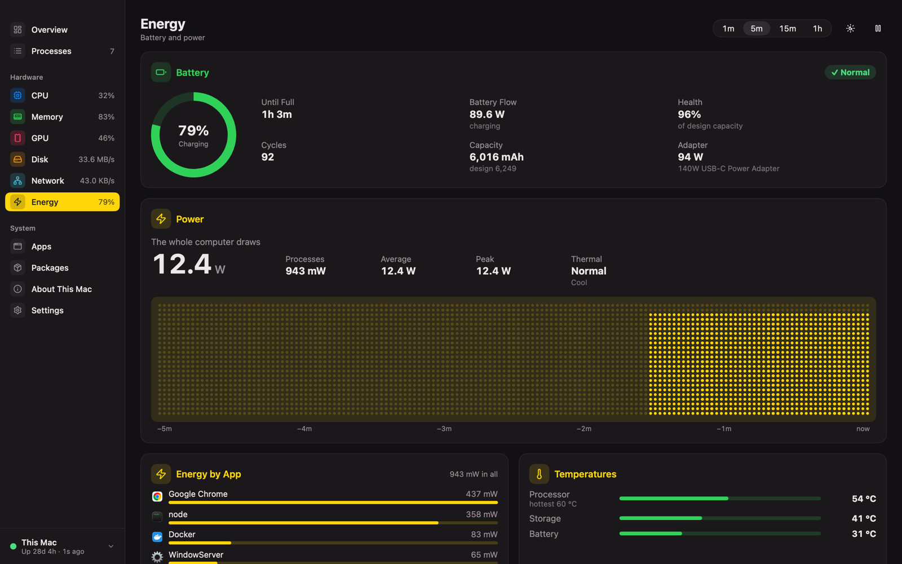
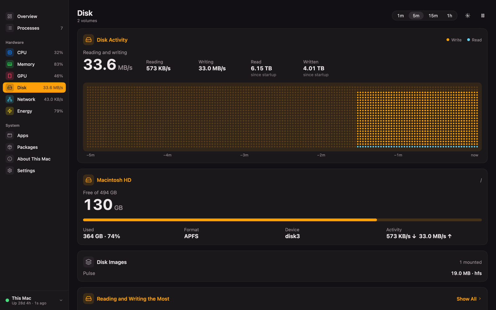
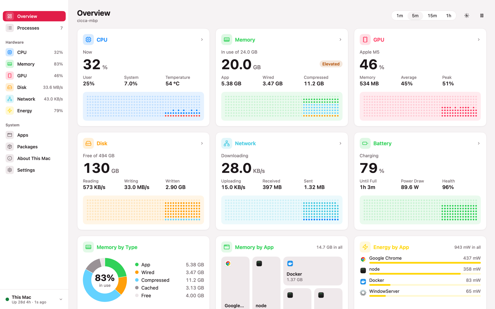
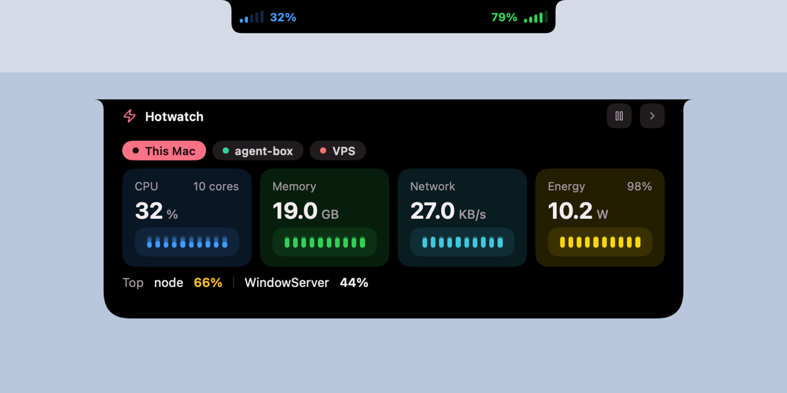

<p align="center">
  
</p>

<h1 align="center">Hotwatch</h1>

<p align="center">
  A small, fast system monitor for your Mac — and for the Linux boxes you look after.
</p>

<p align="center">
  
  
  
  
</p>

<p align="center">
  
</p>

Hotwatch shows what your machine is doing — CPU, memory, disk, network, GPU,
battery and every process — in one native window, and it shows the same for
remote Linux hosts: a VPS, a home server, a GPU box. It is written in Go on
[mygo](https://github.com/egoist/mygo), draws its own UI, and needs no cgo,
Electron or web view.

I built it because I wanted one place to glance at my laptop, my build box
and my VPS, without opening three terminals.

## What's in it

- **Overview** — every metric as a card with a live dot chart; click a card to dive in.
- **CPU** — load split into user and system time, per-core bars (performance and
  efficiency cores apart), die temperature, load averages and the busiest apps.
- **Memory** — app, wired, compressed and cached memory the way Activity Monitor counts
  them, memory pressure, page-ins, swap, and a map of which apps hold the most.
- **Disk** — read/write rates, totals since boot, every volume by name, mounted disk
  images, and the apps doing the most I/O.
- **Network** — download/upload with peaks, a card per interface (Wi-Fi, Ethernet, each
  VPN) with its addresses, per-app traffic and listening ports.
- **GPU** — Apple GPUs (renderer and tiler load, memory) and NVIDIA cards on Linux.
- **Energy** — battery health and cycles, charge rate, the adapter, what the whole
  computer draws, per-app energy, temperatures, and what keeps the Mac awake.
- **Processes** — a fast table of every process with search, tree view, a detail panel,
  and terminate / force quit (with confirmation, and never the wrong process: a
  process is identified by PID *and* start time).
- **Apps** — installed apps with size, architecture and source; Homebrew casks show
  their pending update and can be updated in place. Homebrew formulae and mise tools
  live in the same page.
- **Docker** (remote hosts) — containers with state, health and usage; start, stop,
  restart, and live logs.
- **The notch** — on MacBooks with a notch, CPU and memory sit right beside it. Rest
  the pointer on the notch and an island drops down with the essentials.
- Light and dark, following macOS or set by hand.

<table>
  <tr>
    <td></td>
    <td></td>
  </tr>
  <tr>
    <td></td>
    <td></td>
  </tr>
  <tr>
    <td></td>
    <td></td>
  </tr>
</table>

<p align="center">
  
</p>

## How remote hosts work

Each Linux host runs `hotwatch-agent`, a single static binary (about 11 MB) under
systemd. It never listens on a public address:

- **Tailscale** — the agent binds to the host's Tailscale IP only; the app talks to it
  over your tailnet.
- **SSH tunnel** — the agent binds to `127.0.0.1`; the app opens an SSH tunnel with
  your existing key or ssh-agent.

Every request carries a per-host token. The host stores only its SHA-256; the Mac
keeps the token in the Keychain. An agent can also run read-only, refusing every
action that changes something.

## Getting started

You need Go 1.27 and a Mac on Apple silicon running macOS 14 or later. That's it —
no Xcode, no Node.

```sh
git clone https://github.com/letranminhdat1516/hotwatch.git
cd hotwatch
make app                                  # dist/darwin-arm64/Hotwatch.app + .dmg
open dist/darwin-arm64/Hotwatch.app
```

`make app` signs the app with the identity in `mygo.json`. Put your own
certificate there (`security find-identity -p codesigning` lists them), or use
`"-"` for an ad-hoc signature that runs on your own Mac. For a quick unsigned run
while hacking, `make run` does `go run ./cmd/hotwatch`.

> A signed build keeps one identity across rebuilds, so the Keychain asks for the
> host tokens once — answer **Always Allow**. Unsigned builds look like a new app
> to the Keychain every time and ask again.

### Adding a Linux host

```sh
make agent                                # dist/hotwatch-agent-linux-{amd64,arm64}
scp dist/hotwatch-agent-linux-amd64 deploy/install.sh deploy/hotwatch-agent.service you@host:/tmp/
ssh -t you@host 'cd /tmp && mv hotwatch-agent-linux-amd64 hotwatch-agent && sudo sh install.sh tailscale'
```

Use `ssh` instead of `tailscale` for a host you reach over SSH. The installer
shows each step and asks before doing it; it installs nothing but the agent and
its unit. It prints a token once — paste it into **Add host…** in the app.

Docker support needs nothing extra: if the agent's user can reach the Docker
socket, the Docker page appears.

## Development

```sh
go test ./...                             # everything that runs on a Mac
go vet ./...
make agent                                # cross-compile the agent
go run ./cmd/hwshot /tmp/cpu.png cpu 0 - dark   # render any page to a PNG
```

The Linux collector and agent tests are meant for Linux; I run them in a
`golang:1.27` container (`scripts/box.sh`). The Docker lifecycle test talks to a
real daemon and is behind a build tag: `go test -tags dockerint ./docker`.

```
cmd/hotwatch         the Mac app
cmd/hotwatch-agent   the Linux agent
collect/             metric collectors (darwin, linux)
hub/                 polling, history, connection state, actions
ui/                  shell, pages, components, the notch island
mac/                 macOS bits: app icons, notch, sensors, apps, Homebrew/mise
agent/, transport/   the agent's API, auth, SSH tunnels
deploy/              installer and systemd unit
tools/iconart        draws the app icon
```

Settings live in `~/Library/Application Support/Hotwatch/config.json`. To see
where CPU time goes, start the app with `HOTWATCH_CPUPROFILE=/tmp/cpu.prof`; it
writes a profile of its first minute.

## Status

Hotwatch is young and used daily on one MacBook Pro (M5), one GPU workstation
and one VPS. Things I know about:

- The app uses about 1.5–3 % of one core at a one-second refresh; the agent on a
  small VPS uses more CPU than I'd like.
- The Vietnamese translation exists but isn't wired into the pages yet.
- There's no menu-bar item (the notch covers that on notched Macs).
- Builds are signed for development; shipping to other Macs needs a Developer ID
  and notarisation.

<details>
<summary>Requirement traceability (last verified 2026-10-15)</summary>

Checked on 2026-10-15 at the commit that adds this table. Every result below
is from a run in that session. "Live" is the real app on this Mac with three
hosts: This Mac, agent-box over Tailscale, and the VPS over an SSH tunnel.

Suite: `go test -count=1 ./...` on the Mac → **33 ok, 4 without tests, exit 0**.
`scripts/box.sh --docker 'go vet ./... && go test -count=1 ./...'` on agent-box
→ **28 ok, exit 0**. `go vet ./...` clean, `gofmt -l .` empty.

| ID | Requirement | Code | Test | Status | Evidence |
|---|---|---|---|---|---|
| R1 | Overview cards (CPU, memory, disk, network, GPU, battery), each opening its page | `ui/pages/overview.go` | `TestOverviewCardsFollowTheReference`, `TestOverviewCardsOpenTheirPages`, `TestOverviewAnalyticsRow` | ✅ | suite green; live window captured (CPU 17 % at 41 °C, memory 16.7 GB, battery 100 % charging) |
| R2 | CPU: total, per core, load, history, top processes | `ui/pages/cpu.go`, `collect/darwin/cpu.go`, `mac/sensors` | `TestCPUPage*` (5) | ✅ | suite green; cores split 4 P + 6 E as on the M5 |
| R3 | Memory: App/Wired/Compressed/Cached, swap, pressure, by app | `ui/pages/memory.go`, `collect/darwin/mem.go` | `TestMemory*` (8), `TestMemoryMatchesActivityMonitor` | ✅ | within 3 % of `vm_stat` read before and after the sample; 5/5 alone and in the full suite |
| R4 | Disk: volumes, rates, totals since startup, top I/O | `ui/pages/disk.go`, `collect/darwin/disk.go` | `TestDisk*` (4), `TestParseImageDisks`, `TestParseAPFSVolumeNames` | ✅ | real sample: "Macintosh HD", 6.24 TB read and 4.11 TB written since startup, a mounted .dmg detected |
| R5 | Network: interfaces, addresses, rates, listening ports, per-process traffic | `ui/pages/network.go`, `collect/darwin/net.go`, `netkind.go`, `nettop.go` | `TestNetwork*` (6), `TestParseNettopKeysByPID`, `TestInterfaceKind` | ✅ | real sample: en0 Wi-Fi, utun8 VPN 100.123.1.44; one nettop run ≈ 10 ms |
| R6 | GPU (Apple IOKit; NVIDIA on Linux) | `ui/pages/gpu.go`, `gpu/apple`, `gpu/nvidia` | `TestGPU*` (8), `TestFromStatsEngines`, `TestReadAppleGPU` | ✅ | real sample: Apple M5 70 %, renderer 70 %, tiler 47 % |
| R7 | Energy: charge, flow, health, adapter, whole computer, temperatures, keeping awake | `ui/pages/energy.go`, `power/` | `TestEnergy*` (8), `TestAdapterAndSystemPower`, `TestReadBatteryMatchesPmset` | ✅ | real sample: adapter 94 W "140W USB-C Power Adapter" |
| R8 | Processes: table, columns, tree, inspector, terminate/kill | `ui/pages/processes*.go` | `TestProcesses*` (36) | ✅ | suite green; live: 651 processes on the Mac |
| R9 | Apps: size, kind, source, running, uninstall to Trash | `ui/pages/apps.go`, `mac/apps` | `TestApps*` (5), `TestUninstallExecutorTrashesOnlyLocalBundles` | ✅ | hwshot over the real scan: 78 apps, 2 running, 1 update |
| R10 | Homebrew/mise: outdated, update one/all, remove, prune, live log | `ui/pages/packages.go`, `mac/pkgs` | `TestPackages*`, `TestParseBrewInfo`, `TestAppsShowHomebrewUpdates` | ✅ | real `brew info`: mongodb-compass 1.49.2 → 1.53.0 shown; no upgrade was run in this check |
| R11 | Add/edit/remove remote hosts, direct or SSH tunnel | `ui/hostswitch*`, `source/`, `transport/` | `TestAddDirectHostDefaultsPort`, `TestAddSSHHostSavesConfigAndToken` | ✅ | live config: agent-box direct over Tailscale, VPS over an SSH tunnel |
| R12 | Linux agent: static binary, systemd, metrics, processes, Docker | `cmd/hotwatch-agent`, `agent/`, `collect/linux`, `deploy/` | agent and collector suites on agent-box | ✅ | `systemctl is-active` → active on both hosts; amd64 11.7 MB and arm64 10.8 MB built on agent-box |
| R13 | Remote processes with terminate | `ui/pages/processes*.go`, `agent/signal*.go` | `Test*Signal*` (13) | ⚠️ | live: VPS selected, 332 processes listed; terminating a real VPS process was not run (needs the owner's approval) |
| R14 | Docker: list, start/stop/restart, logs | `docker/`, `ui/pages/docker*.go` | `TestDocker*` (28), `TestIntegrationDockerLifecycle` | ✅ | `-tags dockerint` against agent-box's Docker: PASS in 21 s, no `hw-test-` container left |
| R15 | Agent binds Tailscale/127.0.0.1 only, token, read-only | `agent/auth.go`, `agent/config.go` | `TestAuthAndReadOnly` and 17 more | ✅ | `ss -ltnp`: agent-box bound to its Tailscale address, VPS to 127.0.0.1 |
| R16 | Failures never break the UI; age and backoff | `hub/connstate.go`, `hub/poller.go` | `TestBackoff` and 18 more | ✅ | suite green; live footer "Up 15d 23h · 0s ago" |
| R17 | App < 2 % CPU and < 150 MB; agent < 1 % CPU and < 30 MB | — | measured over 60 s | ⚠️ | app at 1 s refresh, 3 hosts, VPS selected: 0.96 s CPU in 60 s = **1.6 %**, RSS **149 MB** (at the limit). Agent RSS 14.3 MB (agent-box), 12.4 MB (VPS). Agent CPU (of one core): agent-box **1.3 %**, VPS **4.0 %** — above target |
| R18 | Own look, light/dark, sparklines, one card system | `ui/components`, `ui/theme.go`, `ui/pages/widgets.go` | `TestThemeTokensMatchTheApprovedDesign`, `TestDarwinDrawsIconsUpright` | ✅ | pages rendered with hwshot and compared with the owner's screenshots; light mode not reviewed in this check |
| R19 | Independent implementation | whole repo | — | ✅ | written from OS documentation; interface icons are Lucide (ISC) |
| R20 | Settings: interval, language, columns, launch at login | `ui/pages/settings.go`, `store/`, `ui/i18n` | `TestSettingsPageChangesIntervalAndUnits`, `TestIntervalDefaults`, `TestEveryEnglishKeyHasVietnamese` | ⚠️ | interval, units and columns work; the Vietnamese catalogue is complete but pages are not switched to it; no launch at login |
| R21 | Menu bar item | `ui/nook` (notch bar instead) | `TestNookFeedAndCommands` | ⚠️ | the notch bar and island show CPU and memory; there is no menu bar status item |
| R22 | Build and ship: `.app`/`.dmg`, agent binaries, installer | `Makefile`, `mygo.json`, `resources/icon.png`, `deploy/` | — | ✅ | `make app` → Hotwatch.app 15.0 MB and Hotwatch 0.1.0 arm64.dmg 4.8 MB; `codesign --verify --deep --strict` OK, Identifier dev.hotwatch.app; agent binaries for amd64 and arm64 built on agent-box |
| R23 | Navigation across the top | `ui/shell.go` | `TestShell*` (9) | ⚠️ | replaced at the owner's request by a left sidebar |
| R24 | Host panel on the right | `ui/shell.go` host switcher | `TestHostSwitch*` (4) | ⚠️ | replaced with R23: hosts are a switcher at the foot of the sidebar |
| R25 | First data < 1 s; page or host switch < 100 ms | `cmd/hotwatch/wire.go` | `TestTimings` | ✅ | app log: `ui.first_data ms=390`; 11 `ui.switch` entries, the slowest 11 ms |

</details>

## License

Hotwatch is released under the [MIT License](LICENSE).

The CICCA logo used as the app icon (`art/logo-cicca.png`, `resources/icon.png`)
is my personal mark and is not covered by the MIT license — please don't reuse
it for your own builds. Icons in the interface are from [Lucide](https://lucide.dev)
(ISC, see `ui/icons/LICENSE`). Hotwatch is built on [mygo](https://github.com/egoist/mygo) (MIT).
